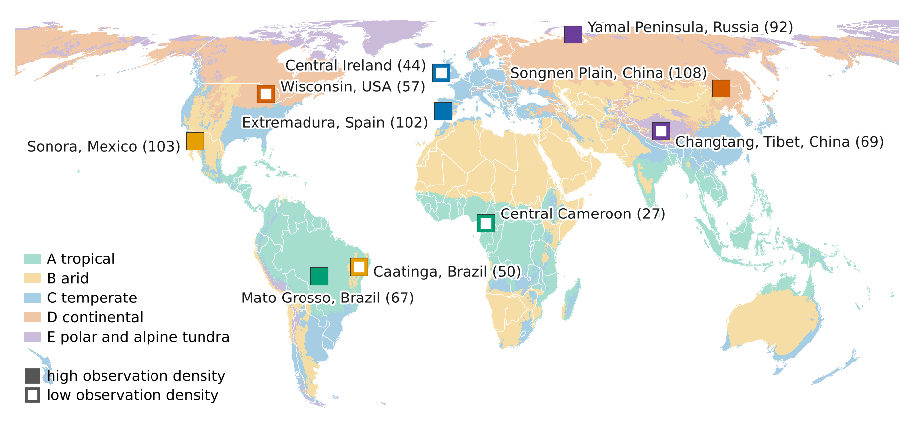

# Screening of focus sites for embedding robustness in Earth observation

Google Earth Engine script to select ten focus sites of 100 x 100 km, two per main
Koeppen climate zone (A tropical, B arid, C temperate, D continental, E polar and alpine
tundra). Within each zone, one site has a high and one a low number of clear Landsat and
Sentinel-2 observations.

## Criteria

| Criterion | Threshold | Data |
|---|---|---|
| 1. Climate zone | ≥ 80% of land area in one main Koeppen zone, ≤ 5% permanent ice | Beck et al. (2018) |
| 2. Observation density | Per zone, one site with a high and one with a low number of clear observations | Landsat 8/9, Sentinel-2 (2018–2025) |
| 3. Orbit overlap | ≥ 1 strip covered by neighbouring orbits (90th/10th percentile of acquisitions ≥ 1.25) | Landsat 8/9, Sentinel-2 |
| 4. Surface classes | ≥ 2 broad classes with ≥ 10% of land area each | ESA WorldCover 2021 |
| 5. Water | ≤ 20% open water | ESA WorldCover 2021 |
| 6. Terrain | ≤ 25% of the area steeper than 20° | Copernicus DEM GLO-30 |
| 7. Archive gaps | Scenes in the weakest year ≥ 50% of the median year | Landsat 8/9, Sentinel-2 (2018–2025) |
| 8. Countries | At most two sites per country | – |

All thresholds are set in the `T` object at the top of the script.

## Files

| File | Content |
|---|---|
| `site_screening.js` | Earth Engine script, stage 1 and stage 2 of the screening |
| `select_sites.py` | Selection of the ten focus sites from the stage 2 table(s) |
| `focus_sites_map.py` | Map of the selected sites on the main Koeppen zones |
| `export_koppen_main_zones.js` | Earth Engine export of the main Koeppen zones (0.1°) for the map |
| `results/site_screening_stage1.csv` | Stage 1 results for all candidates |
| `results/site_screening_stage2.csv` | Stage 2 results for all candidates that pass stage 1 |
| `results/site_selection.csv` | The ten selected focus sites |
| `results/focus_sites_map.png` | Map of the selected sites |

## How to run

1. Download the present-day 1 km Koeppen-Geiger map of Beck et al. (2018) and upload it
   to Earth Engine as an image asset (class codes 1–30, 0 = ocean).
2. Open `site_screening.js` in the Earth Engine Code Editor and, if you use your own copy
   of the map, set `KOPPEN_ASSET` to the path of your asset.
3. Run the script. Stage 1 (climate, surface classes, water, terrain) is printed as
   tables in the console.
4. In the Tasks tab, start the exports `site_screening_stage1` and
   `site_screening_stage2`. Stage 2 counts clear observations and acquisitions for all
   candidates that pass stage 1. With many candidates it can exceed the Earth Engine time
   limit; in that case run it in batches by setting `STAGE2_PREFIXES` (for example to all
   African candidates of zone A) and export each batch separately.
5. Run the selection on one or several stage 2 tables:

   ```
   pip install pandas
   python select_sites.py results/site_screening_stage2.csv
   ```

   This writes `site_selection.csv` with the ten focus sites. For duplicate candidates
   across batches, the last file wins.
6. Optional: export the main Koeppen zones with `export_koppen_main_zones.js` and run
   `python focus_sites_map.py --koppen koppen_main_zones.tif` to draw the map
   (requires `geopandas<1.0`, `rasterio`, `pyproj` and `matplotlib`).

## Selection rule

Per zone, one site with high and one with low clear-observation density is selected
among the candidates that pass all criteria. The pairs of all zones are chosen jointly:
first, the smallest within-zone ratio of clear observations (high / low) is made as large
as possible; among the selections that reach it, the one with the largest product of the
five ratios is taken. Selected sites may not overlap, and at most two sites may lie in one
country. Without the country limit, this is simply the candidate with the most and the one
with the fewest clear observations in each zone.

## Selected focus sites



| Zone | High clear-observation density | Low clear-observation density |
|---|---|---|
| A tropical | Mato Grosso, Brazil (67) | Central Cameroon (27) |
| B arid | Sonora, Mexico (103) | Caatinga, Brazil (50) |
| C temperate | Extremadura, Spain (102) | Central Ireland (44) |
| D continental | Songnen Plain, China (108) | Wisconsin, USA (57) |
| E polar and alpine tundra | Yamal Peninsula, Russia (92) | Changtang, Tibet, China (69) |

Numbers are mean clear observations per pixel and year (2018–2025). Coordinates and all
criteria values are in `results/site_selection.csv` and `results/site_screening_stage2.csv`.

## Notes

Observation counts use simple cloud masks (Landsat `QA_PIXEL`, Cloud Score+ threshold
0.6) with one mosaic per acquisition day. They are meant to rank candidates, not as final
sampling metrics. Candidate centres are listed in `CANDIDATES` and can be extended, for
example with `gridCandidates()`.

## References

Beck, H.E., Zimmermann, N.E., McVicar, T.R., Vergopolan, N., Berg, A., Wood, E.F., 2018.
Present and future Köppen-Geiger climate classification maps at 1-km resolution.
Scientific Data 5, 180214.

Zanaga, D., et al., 2022. ESA WorldCover 10 m 2021 v200. Zenodo.
https://doi.org/10.5281/zenodo.7254221

## Licence

MIT, see `LICENSE`.
